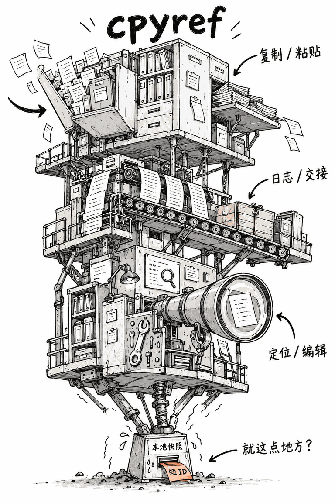

# draw-project-meme

把开源项目画成一张荒诞的工程手绘梗图：上面是庞大、歪斜的功能机器，真正撑着它的却是一只不起眼的小零件。

输入一个项目链接或一段源码，技能会核对实际机制，挑选一个可视化的反差，输出**图片 + 一句话原理 + 简短源码依据**。夸张的是形状和规模，技术因果关系必须真实。



> 实际生成示例：[cpyref 的完整使用示例、绘图提示词和源码依据](examples/cpyref.md)。画中的机器是视觉比喻，不是项目的实际内部架构。

## 使用

将本仓库作为一个包含 `SKILL.md` 的技能目录导入支持 Skills 的 AI 工具，并确保工具有图像生成功能。支持文本提示词模式时，也可以只生成绘图提示词。

直接发送：

```text
用 $draw-project-meme 画这个项目：https://github.com/LIghtJUNction/cpyref
```

也可以控制语言、布局和笑点：

```text
用 $draw-project-meme 把 https://github.com/LIghtJUNction/cpyref 画成英文竖幅梗图。
让机器明显失去平衡，但保留真实的输入、存储和取回关系。
```

只想要可复制的绘图提示词：

```text
用 $draw-project-meme 分析 https://github.com/LIghtJUNction/cpyref。
只输出完整绘图提示词和源码依据，不生成图片。
```

没有仓库或不能联网时，可以直接提供源码：

```text
用 $draw-project-meme 根据以下代码画梗图，不联网：
项目名 SlashMirror。
import sys
print(sys.argv[1].replace('/', chr(92)))
只画字符串中斜杠的替换功能，不要编造其他能力。
```

详细说明见[单功能小工具示例](examples/slashmirror.md)。

## 工作方式

1. 读 README、关键代码和必要的文档，确认用户能看到什么功能。
2. 把真实运行过程还原成简单动作：入队、循环、查表、写本地快照、转换字符等。
3. 根据因果关系选择承重、驱动、分发或转换的物理比喻。
4. 用白底、细黑线、浅灰、歪斜结构与短标注直接生成图；检查小零件是否确实连接主体。

把 README 的未来计划画成已实现能力，或把随机 ID 错画成哈希值，都会破坏这个技能的技术准确性。

## 仓库结构

- [`SKILL.md`](SKILL.md)：实际可调用的工作流和验收规则。
- [`references/visual-direction.md`](references/visual-direction.md)：画风、构图和绘图提示词模板。
- [`assets/example-cpyref.png`](assets/example-cpyref.png)：仓库内的原创生成样图。
- [`examples/cpyref.md`](examples/cpyref.md)：真实项目的输入、事实依据和复现提示词。
- [`examples/slashmirror.md`](examples/slashmirror.md)：只有一项功能时如何画。

示例图片为 AI 生成的技术漫画。相同提示词的再次生成结果可能不同。
