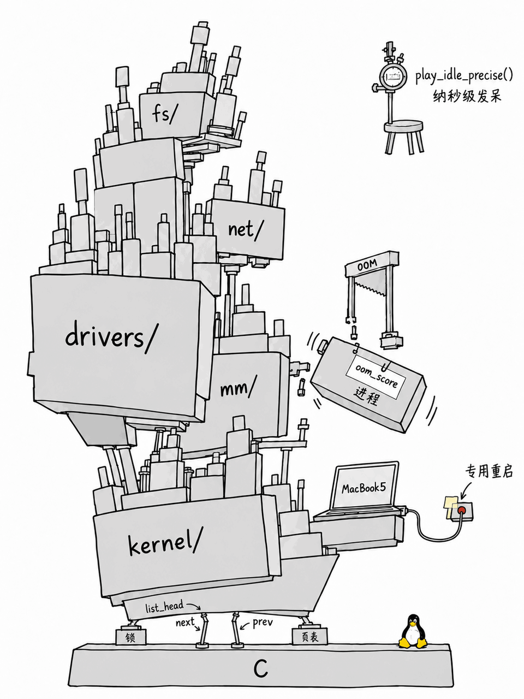

# draw-project-meme

把开源项目画成一本正经的荒诞手绘梗图。输入仓库或源码，输出 **实际图片 + 简短原理 + 可核对的源码依据**。

不是把功能名贴上歪塔，也不靠小人喊“全靠这玩意”。从源码里找具体的反差，再用比例、承重、旁路和冷标签把它画出来。



默认示例已改为 **Linux 内核源码**。见[完整使用示例与源码对照](examples/linux-kernel.md)，以及[实际生成与修改提示词](examples/linux-kernel-prompts.md)。

图中的大小、受力和零件属于比喻，不是模块依赖图、代码规模统计或对 Linux 稳定性的评价。

## 使用

把本仓库作为包含 `SKILL.md` 的技能目录导入支持 Skills 的 AI 工具；要输出图片，该工具需要提供图像生成功能。

```text
用 $draw-project-meme 画这个项目：https://github.com/torvalds/linux
请读内核源代码。要像荒诞基础设施梗图，有可辨认的源码梗、冷旁注和离谱的物理关系。
不要做成功能介绍海报，也不要靠人物对白解释笑点。
```

指定范围：

```text
用 $draw-project-meme 画 Linux 的调度与空闲路径。
读取 torvalds/linux 的 kernel/sched/ 相关代码。
不暗示整个内核只是一个 while 循环。
```

只要提示词：

```text
用 $draw-project-meme 分析 https://github.com/torvalds/linux。
只输出完整绘图提示词和源码依据，不生成图片。
```

不能联网时直接提供代码；技能应按实际能力缩小题材，不虚构功能。见[单功能小工具示例](examples/slashmirror.md)。

## 这版怎么选梗

先核实实际机制和边界，再找物理对应关系。例如 Linux 例图中的两根指针、按评分被清退的进程、机型特定重启分支、精确空闲注入。它们不能直接照搬到其他项目。

默认白底、细黑线、浅灰块体、极少点色、足够留白。标签保持冷静，画面自己荒唐。人物、对白、旁梗数量都不设配额；细节密度不等于幽默。

## 文件

- [SKILL.md](SKILL.md)：调研、选梗、生成、验图与返工规则。
- [references/visual-direction.md](references/visual-direction.md)：视觉语言、提示词骨架与技术边界。
- [examples/linux-kernel.md](examples/linux-kernel.md)：当前主示例，含固定提交和逐项来源。
- [examples/linux-kernel-prompts.md](examples/linux-kernel-prompts.md)：本次实际提示词及局部修正记录。
- [assets/example-linux-kernel.png](assets/example-linux-kernel.png)：当前主示例图片。
- [examples/slashmirror.md](examples/slashmirror.md)：只有一项功能的输入示例。

早期 [cpyref 例图](examples/cpyref.md)保留为历史尝试，不再作为默认示例或画风标准。

示例由内置图像生成功能制作；重复提示词不保证逐像素一致。用户提供的原始参考图未发布到本仓库。
