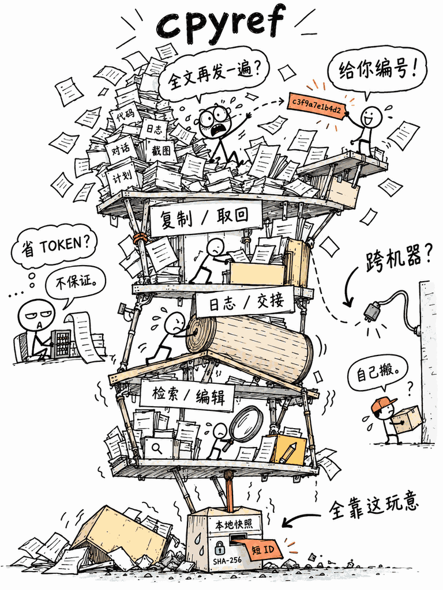

# 历史示例：cpyref（已被 Linux 主示例取代）

这是较早的绘图尝试，保留用于比较，不再作为当前画风标准。现行规则不要求三层阅读时间、固定小人数量或解释性对白。请先看 [Linux 内核示例](linux-kernel.md)。

# 示例：cpyref

项目：[LIghtJUNction/cpyref](https://github.com/LIghtJUNction/cpyref)；读取源码版本 [`a44632d39454`](https://github.com/LIghtJUNction/cpyref/tree/a44632d394540a08d1e7a1e81ffe265028fb122d)。



## 用户输入

```text
用 $draw-project-meme 画这个开源项目：https://github.com/LIghtJUNction/cpyref
用白底黑线的荒诞手绘风，突出那么多功能居然是一个小玩意撑起来的。
```

## 技术事实卡

- **用户能做什么：**复制文件或片段、按编号取回、有限读取与定位、保存测试日志、建立交接记录、生成受控编辑计划。
- **核心过程：**选择字节 → 写入本地快照 → 返回随机短编号 → 通过编号找回快照；另有长度和 SHA-256 完整性检查。
- **真正的小玩意：**本地存储记录与短编号。短编号是随机生成的索引（`c` 加 12 个十六进制字符），**不是内容哈希**。
- **事实边界：**这是同机数据交接，不自动跨机器同步；截图中的机械塔只是视觉夸张。

源码依据：

- [README：功能、限制、同机交接](https://github.com/LIghtJUNction/cpyref/blob/a44632d394540a08d1e7a1e81ffe265028fb122d/README.md)
- [`src/main.rs`：复制时选择字节、保存、输出编号](https://github.com/LIghtJUNction/cpyref/blob/a44632d394540a08d1e7a1e81ffe265028fb122d/src/main.rs#L98-L147)
- [`src/store.rs`：短编号格式、随机分配、持久化](https://github.com/LIghtJUNction/cpyref/blob/a44632d394540a08d1e7a1e81ffe265028fb122d/src/store.rs#L60-L76)（分配逻辑见[后文](https://github.com/LIghtJUNction/cpyref/blob/a44632d394540a08d1e7a1e81ffe265028fb122d/src/store.rs#L390-L443)）

## 为什么要重画

第一版更像精细的工程插画：功能牌子整齐，塔很大，抽屉很小，但除了这个主梗，几乎没有别的故事。[查看第一版](../assets/example-cpyref.png)。

第二版有三层阅读顺序：

1. **3 秒：**一座摇摇欲坠的 Agent 工作塔压在一个可怜的小快照抽屉上。
2. **10 秒：**上层 Agent 快被全文淹没，旁边的人却轻松甩来一张编号纸条；另有人拼命搬一卷日志。
3. **30 秒：**角落的小会计吐槽“省 Token？不保证”，跨机器的快递员被断掉的线堵住，只能“自己搬”。这两点来自项目真实限制。

这些配角是虚构的漫画角色，并非实际维护者；塔和机器也不是 cpyref 的真实架构。图上 `c3f9a7e1b4d2` 一类编号是演示格式，不代表固定值，编号的随机性与 SHA-256 完整性校验是不同的操作。

## 可独立复现的绘图提示词

新版实际制作参考了上一版图片及手绘风格示例，以下是不用参考图片也能尝试复现的设计提示词；重复生成不会逐像素一致。

```text
关于 Rust CLI cpyref 的原创荒诞技术漫画。白纸竖幅 3:4，纤细且抖动的黑线，
笨拙的 2D 涂鸦、错位的矩形、歪斜手写字、曲折箭头、大片留白。
不要精美工程渲染、准确透视、密集阴影、科技蓝或完美装配。

真实原理：用户从文件/管道选择原始字节，存成本地快照，收到随机短 ID，
以后按 ID 取回；支持日志、交接、检索、受控编辑计划。同机为主；不保证节省 Token。
随机短 ID 不是 SHA-256 内容哈希，SHA-256 是完整性检查。

主场景：上方是由歪纸箱、斜支架、文件、日志卷轴临时垫成的巨大功能塔；
底下只有一只比火柴盒大一点的小抽屉写着“本地快照”，
它被整个功能塔压得流汗，抽屉吐出一张橙色小票“短 ID”，
旁边弯箭头写“全靠这玩意”。承重接触要画清楚。

上层小故事：一个瞪大眼的火柴人 Agent 陷在巨大全文纸山里，说“全文再发一遍？”；
另一个笑嘻嘻的火柴人站在边上，举一张小票说“给你编号！”；
旁边另有小人使劲把一大卷日志推上坡。塔各层短标签“复制 / 取回”、
“日志 / 交接”、“检索 / 编辑”。

左侧独立小场景：小会计看着计算器，上面问“省 TOKEN？”，下面干巴巴答“不保证。”
右侧小场景：一条线缆在墙边断掉，小快递员拎箱子站着，写“跨机器？”“自己搬。”
底部可画一个小锁印“SHA-256”，它不生成短 ID，只保护数据完整性。

主笑点必须一眼看懂，小故事要有表情和动作，放大能发现技术彩蛋；
整张像网友认真画的一幅很粗糙、很荒谬的基础设施涂鸦梗图。
少量暗橙与淡红点缀，其余白黑灰。不用无关企业品牌、角色或功能，
不把源码注释、README愿景画成已实现能力。
```

## 图下配文

> Agent：把整份文件再发我一遍！ 另一个人：给你个短编号不就完了？一整个复杂的交接系统，实际靠一个小小的本地快照抽屉。跨机器还得自己搬，省 Token 也不保证。

**画面依据：**上面的代码与 README；其中人物对话、货运塔、表情全属夸张比喻。
